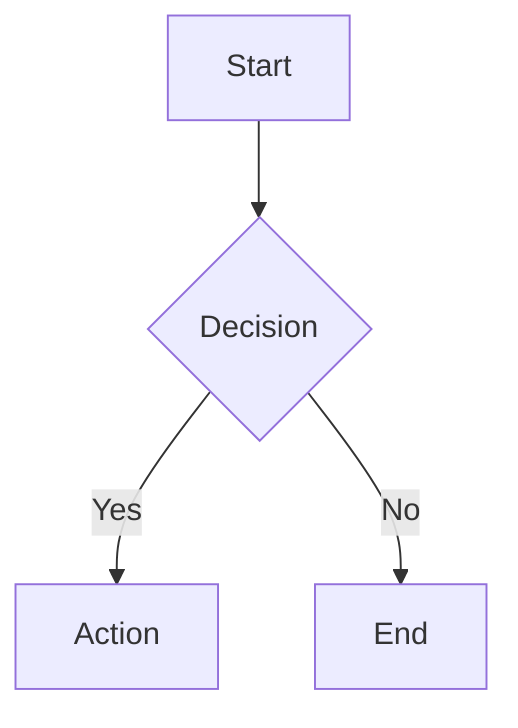
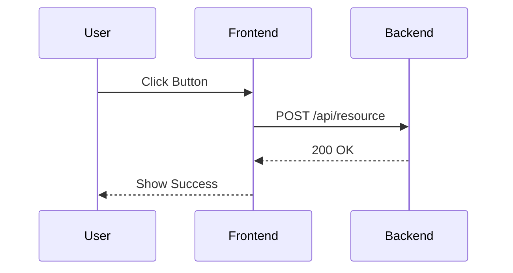
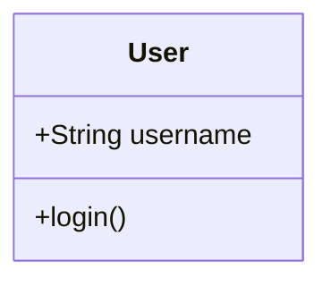

# Technical Documentation Skill

This skill defines the standards for creating, updating, and maintaining documentation within the project.

## 1. Documentation Philosophy
*   **Living Documents**: Documentation must be treated as code. If the code changes, the docs *must* change in the same PR.
*   **Diagrams as Code**: Use Mermaid.js for all diagrams to ensure they are version-controlled and editable.
*   **Conciseness**: Avoid fluff. Be direct and technical.

## 2. Standard Artifacts

### 2.1 README.md (Root & Modules)
Every major module or directory should have a `README.md` containing:
*   **Purpose**: What does this module do?
*   **Key Components**: Main classes/files.
*   **Usage**: Code examples or command lines.

### 2.2 Architecture Diagrams (Mermaid)
Use Mermaid for all visual representations.

#### Flowcharts (Logic Flow)


#### Sequence Diagrams (API Interactions)


#### Class/ER Diagrams (Data Models)


## 3. Code Documentation Standards

### 3.1 Python (Backend)
*   **Style**: Google Style Docstrings.
*   **Coverage**: All public modules, classes, and methods.
*   **Example**:
    ```python
    def connect_to_db(url: str) -> bool:
        """Establishes a connection to the database.

        Args:
            url (str): The connection string.

        Returns:
            bool: True if successful, False otherwise.
        """
        pass
    ```

### 3.2 TypeScript/Vue (Frontend)
*   **Style**: JSDoc.
*   **Coverage**: Complex functions, Composables, and Store Actions.
*   **Example**:
    ```typescript
    /**
     * Authenticates the user with the backend.
     * @param {string} username - The user's identifier.
     * @returns {Promise<void>}
     */
    async function login(username: string): Promise<void> { ... }
    ```

## 4. Workflow for Documenting
1.  **Analyze**: Read the code to understand the current state.
2.  **Plan**: Identify which documents need creation or updates (README, Architecture, API).
3.  **Draft**: Write the documentation in Markdown.
4.  **Visualize**: Create Mermaid diagrams for complex logic.
5.  **Review**: Ensure the docs match the implementation exactly.
