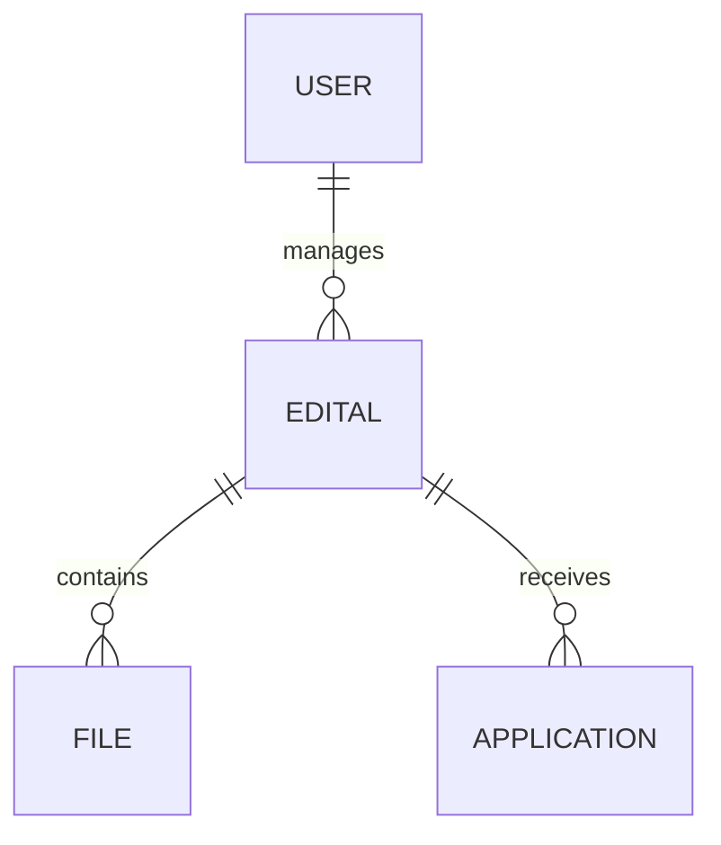

# SI.2 - Analysis & Models

## 1. Domain Entities
*   **Edital**: The central entity. Contains Title, Description, Dates (Open/Close), and Status.
*   **Report**: Analytical derivation of Edital data.

## 2. User Flows
### Create Edital Flow
1.  User clicks "New Edital".
2.  System shows Wizard Step 1 (Basic Info).
3.  User enters data -> Next.
4.  System shows Wizard Step 2 (Files).
5.  User uploads -> Submit.
6.  System validates and sends to API.

## 3. Conceptual Model (Mermaid)

