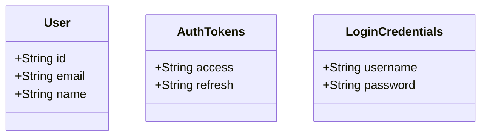
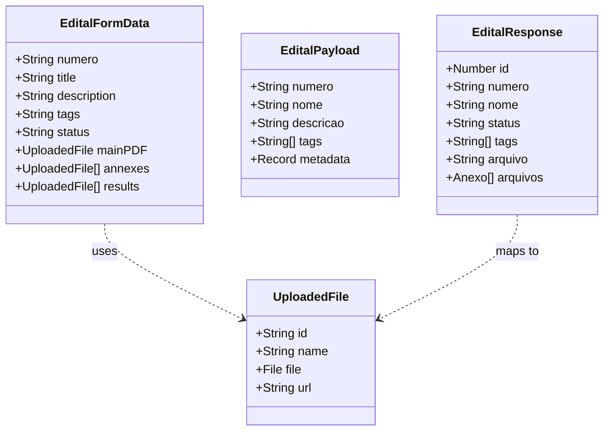

# Data Models & Class Diagrams (SI.3.2)

## 1. Overview
This document defines the data structures (TypeScript Interfaces) used within the Frontend application. It maps the relationship between the UI forms, the API Payloads, and the Backend Responses.

## 2. Core Entities

### 2.1 User & Authentication
Represents the authenticated user and session data.

### 2.2 Edital (Public Notice)
The central entity of the application. The frontend handles three different shapes of this data depending on the context (Form, Payload, Response).

## 3. Data Dictionary

| Interface | Context | Description |
| :--- | :--- | :--- |
| **EditalFormData** | Frontend UI | The reactive object bound to the creation/editing wizard forms. |
| **EditalPayload** | API Request | The transformed object sent to the backend. Notes: `title` becomes `nome`. |
| **EditalResponse** | API Response | The raw data returned by the Django API. |
| **DynamicField** | Metadata | Key-Value pairs for custom metadata added to an Edital. |

## 4. Mapping Logic (Frontend <-> Backend)
Because the Django backend uses generic terms defined in `ItemConhecimento` (e.g., `nome`), the frontend must map these to domain-specific terms (e.g., `title`).

*   **Frontend**: `title` -> **Backend**: `nome`
*   **Frontend**: `mainPDF` -> **Backend**: `arquivo`
*   **Frontend**: `annexes` -> **Backend**: `arquivos` (Related Model)
